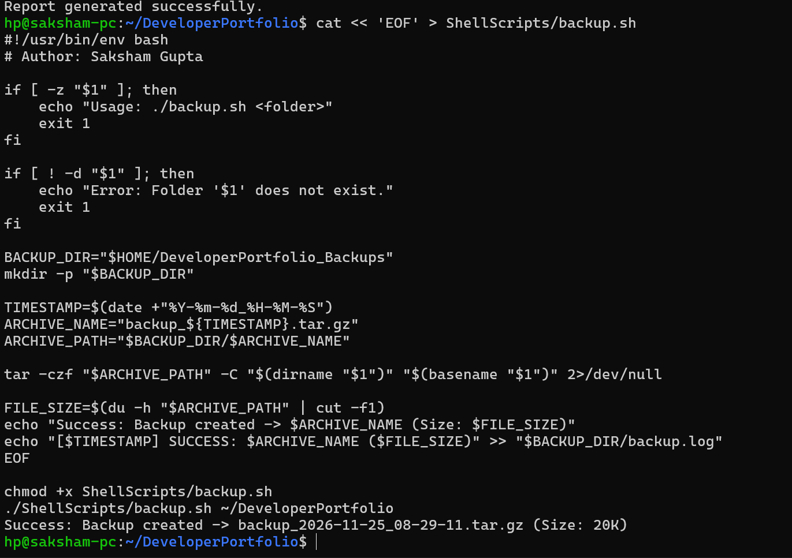
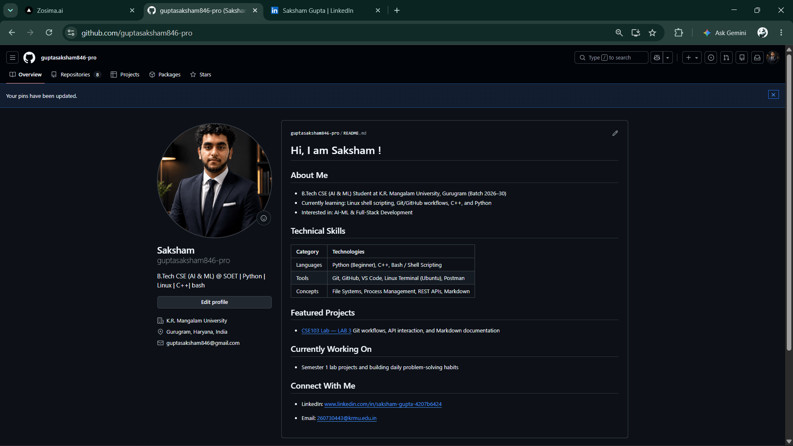
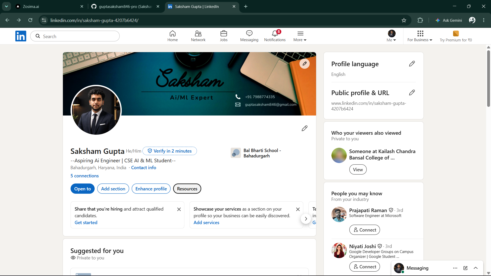

# DeveloperPortfolio

Semester 1 Capstone Portfolio for **B.Tech CSE (AI & ML) at SOET**.

* **GitHub Profile:** [github.com/guptasaksham846-pro](https://github.com/guptasaksham846-pro)
* **LinkedIn Profile:** [linkedin.com/in/Saksham Gupta](https://www.linkedin.com/in/Saksham Gupta)
* **Live Portfolio Website:** [https://guptasaksham846-pro.github.io/DeveloperPortfolio](https://guptasaksham846-pro.github.io/DeveloperPortfolio)

---

## Repository Structure

| Folder | Course Outcome | Contents |
| :--- | :--- | :--- |
| `Linux/` | **CO1** | System hardware profile (`system_profile.md`), binary conversions, and terminal outputs (`commands_output.txt`). |
| `ShellScripts/` | **CO2** | Executable Bash scripts (`sysinfo.sh`, `backup.sh`) and system report (`sysinfo_output.txt`). |
| `API/` | **CO3** | GitHub & JSONPlaceholder API JSON payloads (`github_profile.json`, `sample_posts.json`) and REST summary (`api_summary.md`). |
| `Portfolio/` | **CO4** | Technical resume (`resume.pdf`) and personalized multi-semester roadmap (`learning_roadmap.md`). |
| `Screenshots/` | **Verification** | Visual proof of backup script execution, GitHub profile, and LinkedIn profile. |

---

## Screenshots

### 1. Automated Backup Script Demo

### 2. GitHub Profile

### 3. LinkedIn Profile

